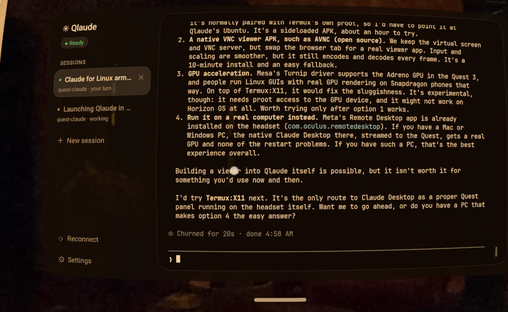

# Qlaude

**Claude Code on your Meta Quest, running on the headset itself. No PC, no Termux.**

Qlaude is a sideloaded Android app that carries its own Ubuntu, installs Claude Code into it on first
launch, and gives you a terminal panel made for a headset: tabs for several Claudes at once,
on-device voice dictation, and tap-to-press for Claude's prompts and shortcuts.



[](https://ko-fi.com/jodeit)

## Install

You need a Quest in [developer mode](https://developers.meta.com/horizon/documentation/native/android/mobile-device-setup/)
and a Claude account (Pro, Max, or an API key).

1. Download [`qlaude.apk`](https://github.com/Jodeit/quest-claude/releases/latest/download/qlaude.apk)
   from the latest release.
2. Sideload it with [SideQuest](https://sidequestvr.com/) or `adb install qlaude.apk`.
3. Open **Qlaude** from *Unknown sources* in your library. The first start unpacks Ubuntu and
   downloads Claude Code: a few minutes and a few hundred MB, once.
4. Claude asks you to log in. Tap the link it shows, sign in in the browser, and you're coding.

Updates install over the old version and keep Ubuntu, your files and your Claude login.

## What you get

- **Sessions**: every Claude runs in its own tmux session, listed in the rail on the left. Each one
  shows whether its Claude is **working**, waiting on **your turn**, or wants you to **approve**
  something, with the topic Claude gave the conversation, so you know what you're switching into.
  **New session** (or Ctrl+T) asks which project in `~` to open; for a git repo the session gets its
  own worktree and branch (`claude -w`), so several Claudes can work on one repo without editing the
  same files.
- **They keep running**: a foreground service keeps Ubuntu and every Claude alive while the panel is
  closed. If the app is updated or killed, your sessions reopen with `claude --resume`.
- **Voice dictation**: on-device [whisper.cpp](https://github.com/ggml-org/whisper.cpp). Tap the mic
  (or Ctrl+Shift+D) and talk; words stream into Claude's prompt as you speak. Nothing is sent until
  you press Enter, and no audio leaves the headset. The first tap downloads the model once.
- **Tap Claude's controls**: numbered options (`❯ 1. Yes`), shortcut hints (`esc to interrupt`,
  `shift+tab to cycle`) and Claude's suggested next prompt are underlined; tap one to press it.
- **Made for a headset**: scroll with the thumbstick or a pinch-and-drag, select and copy straight
  from the terminal, tap links to open them, paste from the Android clipboard. A key dock (Esc,
  Ctrl-C, Tab, Shift-Tab, arrows, Enter) is one tap away, and a Bluetooth keyboard works like a
  normal terminal.
- **· remote**: tap it at the end of Claude's mode line to run `/remote-control`, then carry on with
  that session from claude.ai/code or the Claude app on your phone.

## Let Claude drive the headset (optional)

Claude can see and control the Quest it runs on: take screenshots, open pages, launch and test apps,
install APKs. Inside Qlaude's Ubuntu, from a clone of this repo:

```sh
scripts/setup.sh
```

That puts the `quest` command on the PATH, links the `quest` skill into `~/.claude/skills/` and adds
a status line with context and plan usage. `quest` talks to the headset over its own Wireless
debugging; pair once with `quest pair <port> <code>` (Settings > Developer > Wireless debugging >
Pair device with pairing code). Android switches Wireless debugging off at every reboot; Qlaude's
**Reconnect** turns it back on. `quest help` lists everything.

## How it works

Qlaude ships [proot](https://proot-me.github.io/) and an Ubuntu arm64 root filesystem inside the APK
(fetched at build time by `scripts/fetch-ubuntu-prebuilts.sh`), so it needs no Termux and runs at
`targetSdk` 34. A foreground service keeps a tmux server alive in that Ubuntu, and the panel talks to
it over a single `tmux -C` control-mode pipe: output streams in as Claude writes it, and keys go
straight to the session.

## Build

GitHub Actions builds the APK on every push to `main`; tags `v*` also publish a release with
`qlaude.apk`. From the headset:

```sh
scripts/install.sh --qlaude   # latest successful main build
```

CI signs Qlaude with a private release key kept in the repo's secrets (`QLAUDE_KEYSTORE_B64`,
`QLAUDE_KEYSTORE_PASSWORD`), so only builds from this repo can update an installed Qlaude. Builds
without those secrets (forks, pull requests) use the committed throwaway `debug.keystore` and won't
install over a release.

## Room scans to IFC (experimental)

`spatial/` has **roomscan**, an MCP server that turns an iPhone Pro room scan (Apple RoomPlan,
LiDAR) into an IFC4 building model, with any LLM checking and enriching it: walls with thickness,
doors and windows cut into them, spaces with areas, furniture as IFC classes. It runs on the headset
(Qlaude keeps its Ubuntu alive) or anywhere else with Python. See [spatial/README.md](spatial/README.md).
The iPhone side, [RoomScan](ios/RoomScan/README.md), streams the room to it live while you scan.

## Support

If Qlaude saves you some time, you can [buy me a coffee on Ko-fi](https://ko-fi.com/jodeit) ☕.
There's a link in the app's ⚙ Settings too.

## Quest Claude (the original, Termux-based app)

Qlaude grew out of Quest Claude (`app/`), which drives Claude Code running in Termux instead of
carrying its own Ubuntu. It still works and lives in this repo, but new work goes into Qlaude.

A lightweight Android companion app for Meta Quest that drives
[Claude Code](https://claude.com/claude-code) running in Termux.

Open Quest Claude and it starts everything: Wireless debugging, adb on 5555 (`quest up`), tmux in
Termux, and Claude in a detached tmux session. A live copy of the Claude pane appears in the app, so you never need to open the Termux window. Termux needs one setting, once:
`allow-external-apps=true` in `~/.termux/termux.properties`.

- **Terminal**: the Claude tmux pane, in color, refreshed about once a second (right away after
  you type). Tap it (or ⌨) and type: keys go straight to Claude, like a terminal. With a
  Bluetooth keyboard, Enter sends, Shift+Enter starts a new line, and Ctrl/Alt combos work.
  Scroll back through the conversation with the controller thumbstick, or pinch and drag
  (hand tracking) up and down on the terminal; typing jumps back to the prompt.
- **Tabs**: one per tmux session, above the terminal. Each shows whether its Claude is
  **working**, waiting on **your turn**, or wants you to **approve** something, with the topic
  Claude gave the conversation underneath, so you know what you're switching into. **＋** asks which project in `~` to open;
  for a git repo the tab gets its own worktree and branch (`claude -w`, on by default), so several
  Claudes can work on the same repo without editing the same files. Tap a tab to switch (typing
  and the mirror follow it), ✕ next to the active tab (or a long-press) to close it. A worktree stays in `<repo>/.claude/worktrees/`
  after its tab closes; reopening the same tab name picks it back up.
- **Voice dictation**: on-device [whisper.cpp](https://github.com/ggml-org/whisper.cpp) (`base.en`).
  Tap Dictate (or Ctrl+Shift+D) and talk: words stream into Claude's prompt as you speak and get
  corrected as Whisper hears more. Stop (same shortcut) catches the last words; Esc cancels and
  removes the text. Nothing is sent until you press Enter. Quest has no speech recognizer
  that other apps can use, so it's built in. The first tap downloads the model (57 MB) once.
- **Tap Claude's controls**: numbered options in a prompt (`❯ 1. Yes`, `2. No`) and shortcut hints
  below the input box or in a dialog (`esc to interrupt`, `shift+tab to cycle`, `Tab to amend`) are
  underlined; tap one to press it. Claude's grey suggested next prompt is underlined too: tap it
  to send it. Tapping anywhere else opens the keyboard as before.
- **Key bar**: Esc, Ctrl-C, Clear, Tab, Shift-Tab, arrows, Enter. Esc and Ctrl-C interrupt Claude
  while it works; **Clear** only empties the prompt, so it's safe mid-turn.
- **Status**: Termux installed, RUN_COMMAND permission, USB debugging, and whether adb is listening on `127.0.0.1:5555`.
- **Reconnect**: turns Wireless debugging back on (Android switches it off at every boot), then runs
  `quest up` in Ubuntu, which finds its port, reopens adb on 5555 and turns keep-awake back on.
  Tapping the status bar while 5555 is closed does the same. The app also re-enables Wireless
  debugging at boot and whenever it opens, so Shizuku isn't needed.
- **· remote**: tappable at the end of Claude's mode line (after `auto mode on (shift+tab to cycle)`).
  Runs `/remote-control` in the current tab, so you can drive that tab's Claude (its conversation
  and folder) from claude.ai/code or the Claude app. Each tab connects separately; tap it again in
  that tab to disconnect. It clears an unsent draft first.

### adb without Shizuku

`quest` uses Ubuntu's own adb against the headset's Wireless debugging. Once per headset:

1. Settings > Developer > turn on **Wireless debugging**, then **Pair device with pairing code**.
2. Keep that dialog open and, in Ubuntu, run `quest pair <port> <code>` with the port and code it shows.
3. `scripts/install.sh` grants the app `WRITE_SECURE_SETTINGS` so it can turn Wireless debugging
   back on after reboots.

After a reboot, open Quest Claude and tap **Reconnect** (or run `quest up`).

### How it works

The app never talks to Claude directly. It sends Termux
[`RUN_COMMAND`](https://github.com/termux/termux-app/wiki/RUN_COMMAND-Intent) intents that run
`tmux` commands against a session (default `claude`). **Open Claude** starts or re-attaches the
session in a Termux window, running (by default):

```
proot-distro login ubuntu -- bash -lc 'cd ~ && claude'
```

Both the session name and the command can be changed in ⚙ Settings.

### One-time Termux setup

```sh
pkg install tmux
echo "allow-external-apps=true" >> ~/.termux/termux.properties
termux-reload-settings
```

### Headset control: `quest` and the skill

Inside proot Ubuntu, from a clone of this repo:

```sh
scripts/setup.sh
```

That sets a Claude status line showing context use and your plan usage (5-hour and 7-day limits,
with time to reset) in every tab, puts `quest` on the PATH and links `skills/quest` into `~/.claude/skills/`, so every Claude
session on the headset knows to run `quest up` first and how to take screenshots, open pages,
launch apps and send input. Run `quest help` for the full command list.

### Build & install

There are no Android build tools on arm64 Termux/proot, so GitHub Actions builds the APK on every
push to `main` (tags `v*` also get a GitHub release). From the headset:

```sh
scripts/install.sh          # latest successful main build
scripts/install.sh <run-id> # a specific run
```

That downloads the artifact with `gh`, then `adb install -r -g` and grants the Termux permission.

`debug.keystore` is a throwaway debug key committed on purpose, so every CI build installs over the
previous one. Don't use it for anything you publish.
