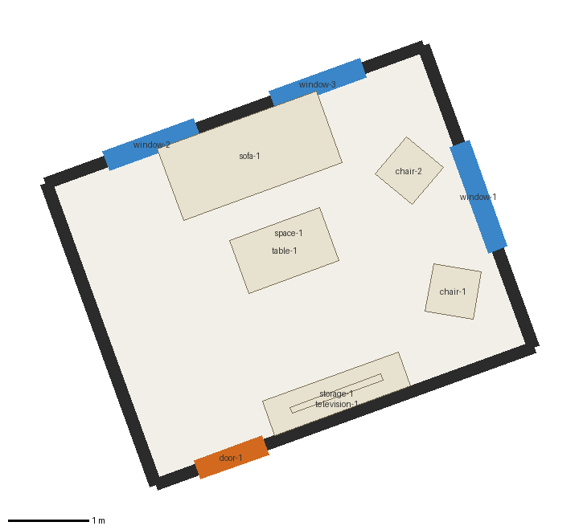

# roomscan: room scans to IFC, over MCP

Scan a room with an iPhone Pro (Apple RoomPlan, LiDAR), and let any LLM turn it into an IFC4
building model: check it, fix it, add what the scanner missed, name things, set properties.

```
iPhone (RoomPlan export) ──POST /scans──▶ roomscan MCP server ◀──MCP── Claude / any LLM
                                              │
                                              └─▶ IfcOpenShell ─▶ model.ifc
```

The phone side is [RoomScan](../ios/RoomScan/README.md), an iOS app that streams the room to the
server while you scan and sends the processed result at the end.

The server runs anywhere Python does: the Quest headset's Ubuntu (Qlaude keeps it running), a Mac,
a PC, a cloud box.



## Quick start

```bash
scripts/roomscan setup                      # once: a venv with ifcopenshell, mcp, pillow
scripts/roomscan convert spatial/samples/living-room.json room.ifc
```

On the headset, `scripts/setup.sh` puts `roomscan` on the PATH; run `roomscan setup` once
(needs `apt install -y python3-venv`).

### With Claude Code on the same machine (stdio)

```bash
claude mcp add roomscan -- roomscan serve
```

Then: *"Import ~/scans/lounge.json, check it against the plan, and build the IFC model."*

### For other machines and LLMs (HTTP)

```bash
roomscan serve --http 0.0.0.0:8765
```

It prints a bearer token (made once, kept in `~/.local/share/roomscan/token`). Every request
except `GET /health` needs `Authorization: Bearer <token>`.

| Endpoint | What it does |
|---|---|
| `POST /mcp` | MCP over streamable HTTP |
| `GET /scans` | The scans stored here |
| `POST /scans?name=Lounge` | Upload a RoomPlan export (JSON body); add `&stage=live` while still scanning |
| `PUT /scans/<id>` | A newer capture of the same scan (`?stage=live` while scanning, none for the final one; `?name=` renames it) |
| `GET /scans/<id>/model.ifc` | Download the last built model |
| `GET /health` | Liveness, no token |

To reach it from claude.ai or another cloud client, put it behind an HTTPS tunnel (Cloudflare
Tunnel, Tailscale Funnel) and pass `--public-url https://…` so `build_ifc` returns download links.

## Digital twin: a scan as a shared page

```bash
roomscan twin Scans.zip out/        # the app's More -> Share scan bundle, zipped or unzipped
```

makes `out/index.html` and what it loads: the room as a photo-real LiDAR mesh (when the scan has a
photo-real pass) and as a dollhouse of photo walls, its spots with the shelves found and their
sizes, photos, and a plan. Publish the folder as a Claude artifact (the `make_twin` MCP tool returns
the recipe) and share it: the team walks the room, measures in it, names spots, and records tape
measurements, products and notes per spot, kept in the artifact's shared store.

The mesh is processed the way photogrammetry tools do it: lined up with RoomPlan's room (undoing
the world jump ARKit makes when its mesh mode starts, then a point-to-plane fit), trimmed to the
room, walls flattened by snapping vertices within 4 cm onto RoomPlan's planes, painted per triangle
from the sharpest (Laplacian variance), most head-on, closest frame where it's the nearest surface
(a depth buffer per frame), with per-frame exposure gains solved from overlaps, re-wound to face
that frame so near walls vanish in the dollhouse view, and shrunk by vertex clustering (2.5 cm).
On a real office scan: 12 s, 96% of the surface painted, 276k triangles.

## MCP tools

| Tool | |
|---|---|
| `list_scans`, `import_scan` | What's stored; store a RoomPlan JSON from a local file |
| `get_scan` | The scan as plan data: spaces (outline, area), walls, doors/windows (host wall, offset, sill), objects (category, IFC class, centre, size, rotation), warnings |
| `get_plan` | The floor plan as a PNG, labelled with element ids |
| `edit_element` | Rename, reclassify, remove a false detection, wall thickness and which side of the scanned face it goes |
| `set_properties` | Any property set, e.g. `Pset_WallCommon.IsExternal` |
| `add_element` | Something the scanner missed, as a box (radiator, column, built-in) |
| `set_names`, `set_defaults`, `add_note` | Project/building/storey names; default wall thickness; notes |
| `build_ifc` | Write the model; returns counts, schema validation errors and a download link |
| `make_twin` | A RoomScan scan bundle -> a shared 3D twin page folder, with the Artifact publish recipe |

Resources: `scans://index`, `scan://<id>/summary` (updates are announced to subscribers),
`scan://<id>/plan.svg`.

While a phone is still scanning, a scan's stage is `live` and its capture is replaced every couple
of seconds; `get_scan` says so. Read it to coach the person scanning; edit once it's `final`
(element ids can shift until then).

Edits never touch the scan. They're kept in `edits.json` next to it, so the model is always
scan + edits, rebuilt from scratch.

## What the model contains

- **Walls**: `IfcWall` per scanned wall, its thickness (default 0.15 m) added *outside* the room
  because the scanner only sees the room-side face. Walls run past corners so outside corners close.
- **Doors and windows**: an `IfcOpeningElement` cuts the wall; a parametric `IfcDoor`/`IfcWindow`
  fills it. RoomPlan openings without a door become just the cut.
- **Spaces**: `IfcSpace` from the wall loop (area, perimeter, volume as `Qto_SpaceBaseQuantities`),
  named from RoomPlan's room label where it has one, over a 200 mm `IfcSlab` floor.
- **Objects**: RoomPlan's 16 categories mapped to IFC (sofa → `IfcFurniture.SOFA`, toilet →
  `IfcSanitaryTerminal.TOILETPAN`, fridge → `IfcElectricAppliance.REFRIGERATOR`, …) as boxes.
- **Provenance**: every element has `Pset_QlaudeScan` with its element id, RoomPlan UUID and scan
  confidence.

## Coordinates

RoomPlan works in ARKit's frame (Y up, origin where the phone started). roomscan converts to IFC's
Z up (`x, -z, y`) and puts each story's floor at z = 0. All tools use that frame, in metres.

## Limits

- Wall thickness is a guess unless the LLM or you set it.
- Several rooms (a RoomPlan `CapturedStructure`) are read, but interior walls get thickness on one
  side only; set `thickness_side: "center"` on shared walls. If the walls don't close into one
  loop, the space outline falls back to a convex hull (with a warning).
- Curved walls are modelled straight (with a warning).
- Objects are boxes, which is all RoomPlan measures.
- The JSON layout follows `JSONEncoder` output of RoomPlan's `CapturedRoom`. The reader accepts the
  variants seen in the wild (16-float or 4×4 transforms, `{"wall":{}}` or `"wall"` categories), but
  it's tested against the generated sample in `samples/`, not yet a real device export.

## Development

```bash
python3 -m venv .venv && .venv/bin/pip install -r requirements.txt pytest
.venv/bin/python -m pytest tests
python -m roomscan sample samples/living-room.json   # regenerate the sample
```

The tests check geometry against the sample room's known layout, run every tool through an
in-process MCP client, and the HTTP token and upload paths.
